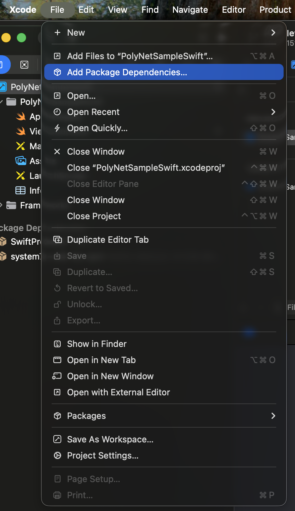
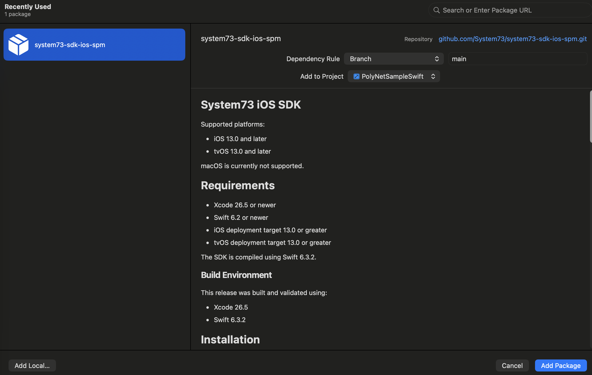
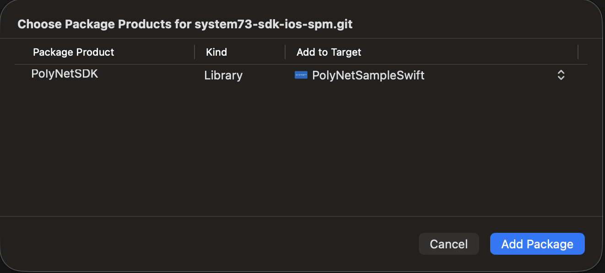

# System73 SDK for iOS & tvOS

Swift Package Manager distribution of the System73 PolyNet SDK.

**Current version:** 5.2.7

## Supported Platforms

- iOS 15.0 and later
- tvOS 15.0 and later

macOS is not supported.

## Requirements

- Xcode 16.0 or newer
- Swift 6.0 or newer
- iOS deployment target 15.0 or later
- tvOS deployment target 15.0 or later

The SDK binary is built and validated with Xcode 16.4.

## Installation (Swift Package Manager)

1. Open your project in Xcode.
2. Go to **File → Add Package Dependencies…**

   <p align="left">
     
   </p>

3. Enter the repository URL in the search field:

   ```
   https://github.com/System73/system73-sdk-ios-spm.git
   ```

   <p align="left">
     
   </p>

4. Set **Dependency Rule** to **Up to Next Major Version** (for example, from `5.2.7`) or choose **Exact Version** and select a specific release.
5. Add the package to your app target.

   <p align="left">
     
   </p>

Xcode resolves and links all required components automatically.

### Using Package.swift directly

```swift
dependencies: [
    .package(
        url: "https://github.com/System73/system73-sdk-ios-spm.git",
        from: "5.2.7"
    )
],
targets: [
    .target(
        name: "YourApp",
        dependencies: [
            .product(name: "PolyNetSDK", package: "system73-sdk-ios-spm")
        ]
    )
]
```

## Usage

### Import

```swift
import PolyNetSDK
```

### Initialization

Initialize the SDK before starting playback, for example during view setup or app startup.

```swift
import UIKit
import PolyNetSDK

final class ViewController: UIViewController {

    var polyNet: PolyNet?

    func initialize() {
        do {
            polyNet = try PolyNet(
                manifestUrl: "<MANIFEST_URL>",
                channelId: "<CHANNEL_ID>",
                apiKey: "<API_KEY>",
                contentSteeringEndpoint: "<CONTENT_STEERING_ENDPOINT>" // optional, pass "" if unused
            )
        } catch {
            print("PolyNet initialization failed: \(error)")
        }
    }
}
```

## Included Components

The package provides:

- **PolyNetSDK**: core SDK (binary xcframework)
- **WebRTC**: real-time communication, pulled in automatically as a platform-specific dependency:
  - iOS: [`system73-webrtc-ios-spm`](https://github.com/System73/system73-webrtc-ios-spm) (1.0.1)
  - tvOS: [`system73-webrtc-tvos-spm`](https://github.com/System73/system73-webrtc-tvos-spm) (1.0.1)
- **SwiftProtobuf**: protocol serialization

No additional setup is required. After adding the package, all SDK features become available.

> **Note:** The WebRTC packages are pinned to exact versions. If your app already depends on a different WebRTC package, you may see dependency conflicts.

## Architecture Support

`PolyNetSDK.xcframework` includes the following slices:

**iOS**
- arm64 (devices)
- arm64 and x86_64 (simulator)

**tvOS**
- arm64 (devices)
- arm64 and x86_64 (simulator)

Compatible with both Apple Silicon and Intel Macs.

## Troubleshooting

### No such module 'PolyNetSDK'

- Clean the build folder (**Shift + Command + K**)
- Restart Xcode
- Reset package caches (**File → Packages → Reset Package Caches**)
- Confirm the package is added to the correct target under **Frameworks, Libraries, and Embedded Content**

### Package resolution failed

- Verify the repository URL
- Check your internet connection
- Delete DerivedData:

  ```bash
  rm -rf ~/Library/Developer/Xcode/DerivedData
  ```

- Clear the SwiftPM cache:

  ```bash
  rm -rf ~/Library/Caches/org.swift.swiftpm
  ```

### Failed to download binary artifact / checksum does not match

The SDK binary is hosted at `artifacts.s73cloud.com`, not on GitHub.

- Make sure your network, VPN, firewall, or proxy allows access to `artifacts.s73cloud.com`
- Reset package caches and resolve again
- If the checksum error persists, contact support with the SDK version you are using

### Swift version compatibility error

- Make sure you are using Xcode 16.4 or newer
- Make sure your project's Swift version is 6.0 or newer

## Support

For more information, visit [system73.com/docs](https://system73.com/docs) or [contact us](mailto:support@system73.com).

For questions or bug reports, please [open a GitHub issue](https://github.com/System73/system73-sdk-ios-spm/issues).

---

© 2026 **System73®**. All rights reserved.

